<a href="https://tobias-livadariu.github.io/tobias-livadariu/?line=68#play/minecraft-classic"><picture><source media="(prefers-reduced-motion: reduce)" srcset="./assets/profile-terminal.v15.still.svg" /></picture></a>

<!--
  Generated by scripts/render-profile-readme.mjs.
  The SVG precomputes the islands-1 spritesheet into colored ASCII frames so
  GitHub only loads one static image instead of running a client-side filter.
-->
