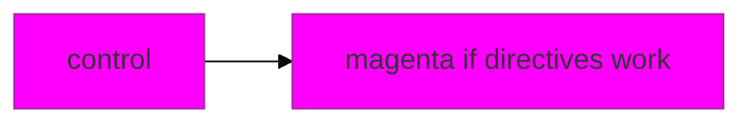
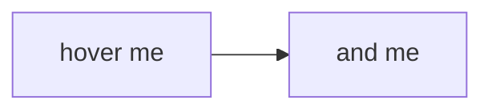
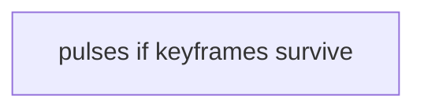

# Temporary Mermaid CSS probe

Checks whether GitHub's Mermaid renderer keeps custom CSS, and whether `:hover`
works inside it. Delete this directory once answered.

## 1. Control: themeVariables through an init directive

## 2. themeCSS through an init directive

## 3. themeCSS through frontmatter config

## 4. Keyframe animation through themeCSS (no hover needed)

## 5. Star trail grid (block diagram)

```mermaid
%%{init: {"themeCSS": ".block rect, .node rect{fill:#0d1117 !important;stroke:#0d1117 !important;transition:fill 1.5s ease-out} .node:hover rect{fill:#e3cf65 !important;transition:none}"}}%%
block-beta
  columns 8
  s1[" "] s2[" "] s3[" "] s4[" "] s5[" "] s6[" "] s7[" "] s8[" "]
  s9[" "] s10[" "] s11[" "] s12[" "] s13[" "] s14[" "] s15[" "] s16[" "]
  s17[" "] s18[" "] s19[" "] s20[" "] s21[" "] s22[" "] s23[" "] s24[" "]
```

